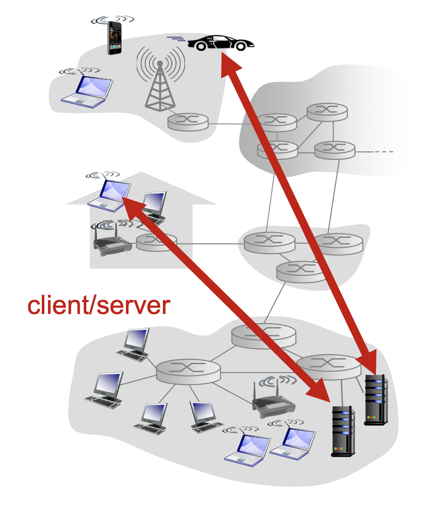
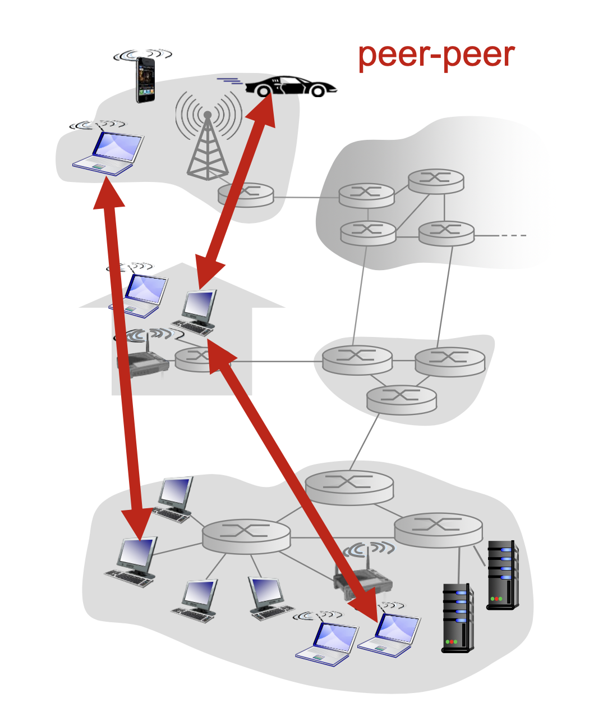
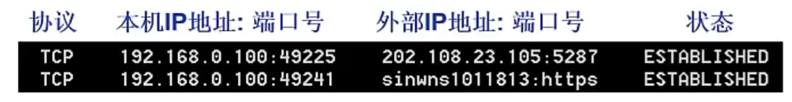
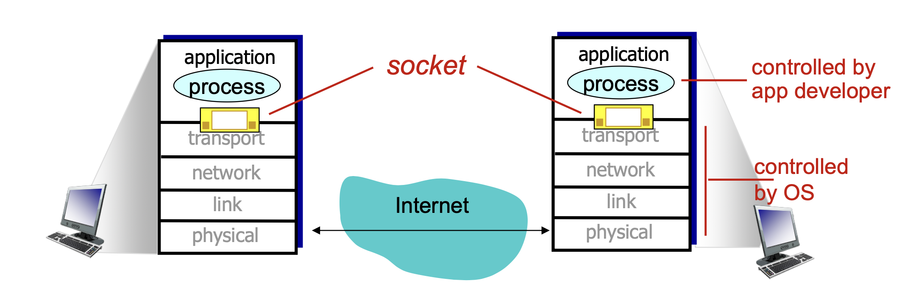
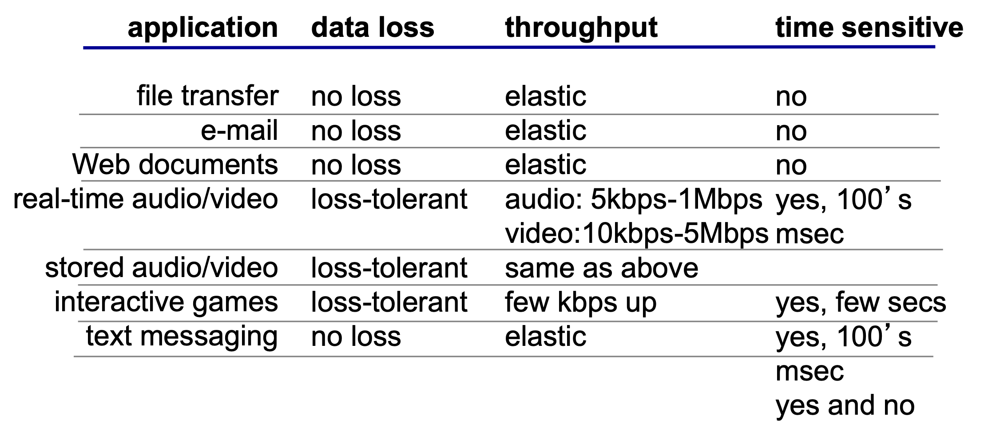
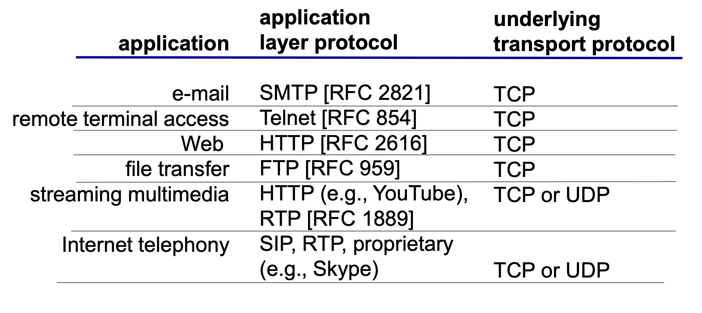

# 网络应用 (Network Application)

## 应用架构

### Client-Server

服务器 (Server) 有以下特点：

- 7*24小时提供服务
- 永久性访问域名/IP地址
- 利用大量服务器实现可拓展性

客户机 (Client) 有以下特点：

- 与服务器通信，使用服务器提供的服务
- 间歇性接入网络
- 可能使用动态的IP地址
- 不会与其他客户机直接通信

典型例子：浏览器

### Peer-to-Peer (P2P)

在P2P软件架构有以下特点：

- 没有永远在线的服务器
- 任意节点之间可以直接通信
- 节点间歇性地接入网络并且IP地址可能改变
- 节点同时向其他节点提供服务 (server) 或者接受其他节点的服务 (client)

典型例子：AirDrop

## 网络应用的进程通信 (Process Communication)

网络应用的核心是网络应用的进程进行通信，然后完成一些功能。

### 进程

进程：主机 (host) 上运行的程序。

- 同一主机上的进程如何通信：由操作系统提供

- 不同主机上的进程如何通信：消息交换 (message exchange)

在进行进程通信的时候有两种角色：

- 服务器进程 (server process)：等待通信请求的进程，提供服务
- 客户机进程 (client process)：发起通信请求的进程，接受服务

> P2P架构中也有服务器进程和客户机进程。

### 进程寻址

为了能够定位进程，每个进程必须有进程标识符：

**进程标识符 (identifier) = IP address: port number**

和在一起表示某个主机上的某个进程服务。

- IP address：每个主机拥有的32位独特地址

- port number：主机上每一个需要通信的进程分配的端口号

> HTTP Server: 80
>
> Mail Server: 25

### socket

**进程之间通信使用socket实现接收/发送信息**。

socket类似于邮箱，进程将消息放到门外邮箱，通信基础设施将消息移到另一个进程的socket。

## 应用层协议 (App-Layer Protocol)

### 应用层协议内容

进程之间交换消息需要遵循应用层协议，其定义了以下内容：

- 交换消息的类型：`request`, `response`

- 消息语法：消息包含哪些字段，每个字段如何描述
- 消息语义：规定每个字段的含义
- 发送和响应规则：协议还规定进程在什么情况下发送消息，以及收到消息后应该怎样处理

### 应用层协议分类

应用层协议分为：

- 开放协议 (open protocol)：通常记录在 **RFC（Request for Comments）**文档中
- 私有协议 (proprietary protocol)：私有协议由某个公司或组织自行设计和控制

> 开放协议例如HTTP, SMTP, TCP, IP允许不同组织独立开发软件，并且仍然能够互相通信。

## 传输服务 (Transport Service)

### 传输服务要求

网络应用对传输服务有以下要求：

- data integrity 数据完整性：部分应用要求百分之百无损，部分应用能够接受一定程度的损失
- timing 实时性：部分应用要求很低的延迟
- throughput 吞吐量：对于部分应用，吞吐量要达到一定要求才会流畅
- security 安全性：部分应用要求极高的安全性

### 互连网提供的传输服务

互连网提供两类传输服务：

1. TCP service：

   - **服务器和客户机之间**建立的连接

   - reliable transport 可靠的传输：保证可靠的端到端字节传输

   - flow control 流量控制：发送方发送速度不会超过接收方处理能力

   - congestion control 拥塞控制：网络负载过重时会限制发送方速度

2. UDP service：
   - 无连接
   - 不可靠的数据传输

> [!NOTE]
>
> TCP不提供时间/延迟保障，不提供最小带宽保障。

> - TCP在正式传输数据之前需要进行3次握手，建立连接之后才会传数据
> - UDP不进行握手，只要有进程标识符就可以直接传输数据，这就是**无连接**的含义

