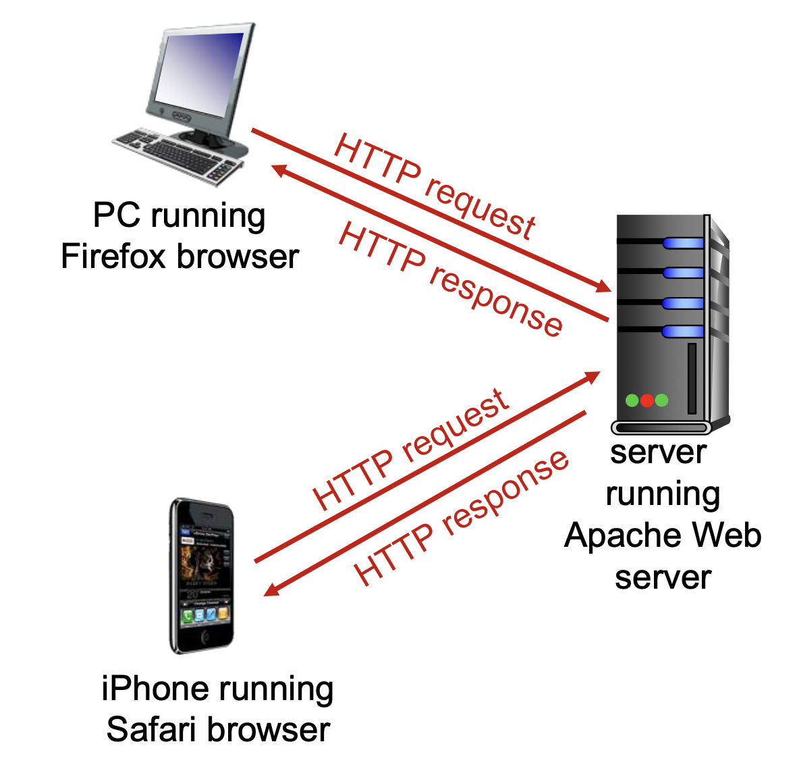
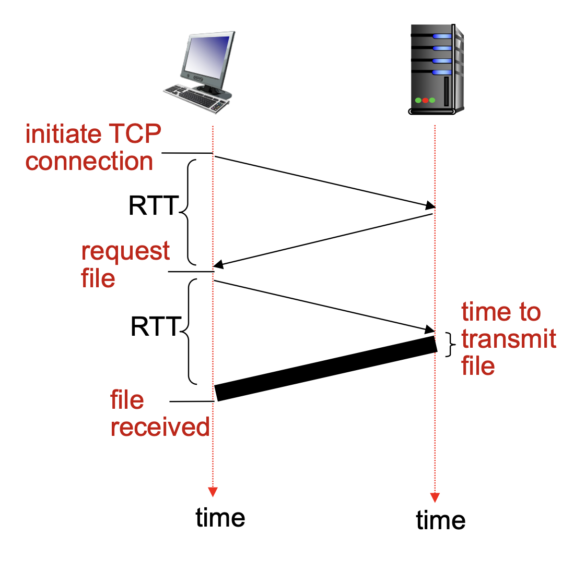
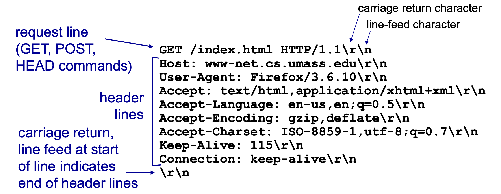
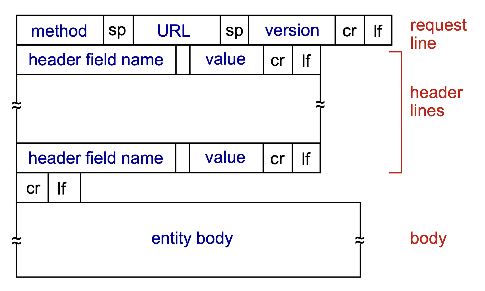
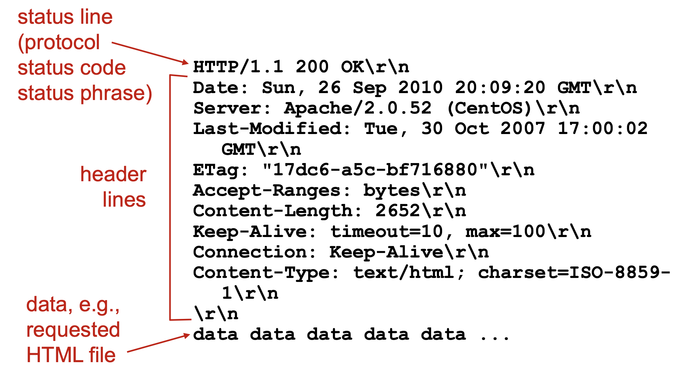
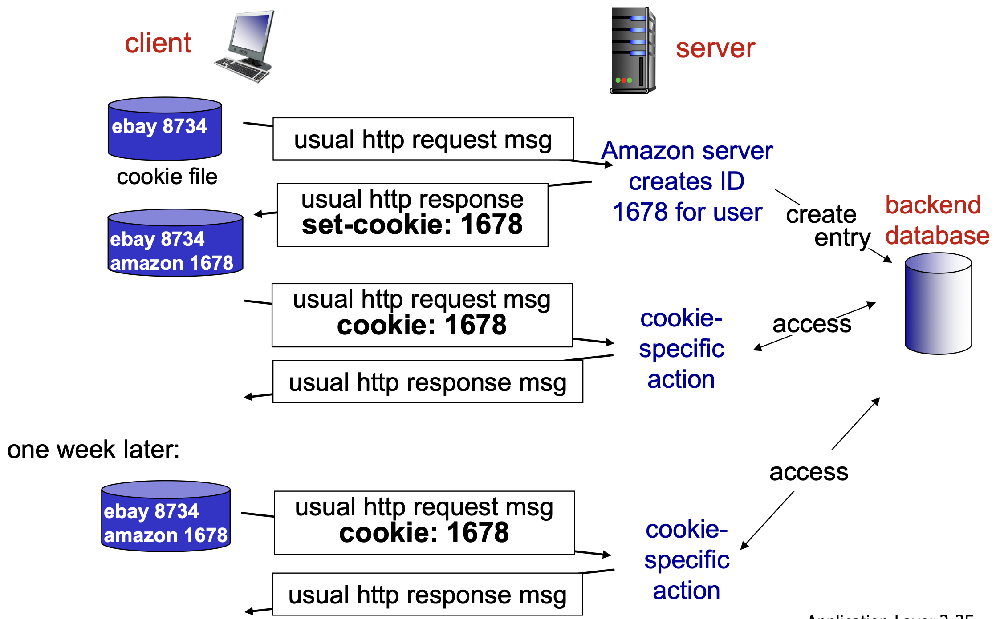

# Web and HTTP

## 概念

### web

什么是web：

- web包含大量的网页 (web page)
- 网页之间相互连接

什么是网页 (web page)：

- 网页中包含多个对象 (object)，**每个对象都能通过URL寻址**

- 网页包含base HTML-file，其中有对于其他对象的引用的链接

> [!NOTE]
>
> URL格式：`scheme://host:port/path`
>
> - `scheme` 协议：如果是HTTP/HTTPS一般就直接省略
> - `host:port`：`port`一般省略了，和协议一样
> - `path` 路径：资源路径
>
> 

> 网页中的对象包括：HHHTML file, JPEG image, Java applet, audio file

> HTTP协议默认端口号80，HTTPS协议默认端口号443。
>
> 在HTTP/HTTPS协议中，只有使用非默认端口时才需要手动写上端口号。

### http

http全程 hypertext transfer protocol 超文本传输协议，是web的应用层协议，使用client-server架构。

- client - browser：请求、接收并展示web对象
- server - web server：响应客户的请求并发送对象

HTTP使用TCP作为传输层协议 (transport protocol)：

1. 客户端向服务器端口80发起TCP连接并创建socket
2. 服务器接受TCP连接
3. 浏览器 (http客户端) 和 web 服务器 (http服务器) 交换 http 信息
4. TCP连接关闭

> [!NOTE]
>
> **HTTP是无状态的 (stateless)：服务器不维护过去客户端请求的信息。**
>
> 有状态的协议非常复杂：
>
> - 过去的历史记录需要维护
> - 服务器/客户端失效会产生状态不一致，解决这种问题的代价高昂

## HTTP连接

### non-persistent HTTP

每次TCP连接中只传送一个对象，随后TCP连接就会关闭。如果需要下载多个对象，则需要多次TCP连接。

Round Trip Time (RTT)：从客户端发送很小数据到服务器返回结果的时间。

**HTTP response time：$2RTT+ file \ transmission \ time$**

1. 1 RTT to initiate TCP connection with the server

2. 1 RTT for http request and first few bytes returned

3. transmission time for the whole pack of data from the server to the client

### persistent HTTP

client-server之间的TCP连接一旦建立就保持住，然后传输多个对象。

- client遇到了需要索引的对象就立即发送请求
- **大约只需要1RTT来得到所有索引的对象**

## HTTP消息格式

HTTP/1.x消息的类型是ASCII，人能够直接阅读的格式。

### request

HTTP请求的格式：

- method：`GET`, `POST`, `HEAD`, `PUT`, `DELETE`
- header lines：告诉服务器怎么处理这次请求
- entity body：承载客户端向服务器提交的内容，`POST`请求中需要

> - `HEAD`：只获取响应头，不返回响应体。查看文件是否存在、大小或最后修改时间，而不下载文件。
>
> - `PUT`：将请求体中的内容放到指定 URL，通常用于创建或整体替换资源。把一份用户资料保存到 `/users/42`。
>
> - `DELETE`：请求删除指定 URL 对应的资源。删除 `/users/42`。

#### 上传信息

有两种方式从客户端向服务器上传输入：

- `POST`请求：客户端需要上传的信息放在entity body中给服务器
- `GET`请求：上传内容通过URL中特定的字段

### response

HTTP响应格式：

- protocol：使用的协议
- status code：`200`表示`OK`，`301`表示`Moved Permanently`，`400`表示`Bad Request`，`404`表示`Not Found`，`505`表示`HTTP Version Not Supported`
- status phrase：和status code一一对应
- header lines：响应携带的相关信息
- data：实际返回的响应数据

## Cookie

由于HTTP是无状态的 (stateless)，服务器不维护过去客户端的信息，所以诞生了cookie技术。

**Cookie的主要作用是让服务器在多次 HTTP 请求之间认出同一个客户端。**

- cookie信息被携带于HTTP request/response中的header lines
- cookie文件保存在客户端本地，被浏览器所管理

> 实际例子：
>
> 1. 浏览器提交账号密码
> 2. 服务器验证成功，在响应中发送：`Set-Cookie: session_id=abc123`
> 3. 浏览器保存这个 Cookie
> 4. 之后访问该网站时，浏览器在请求中带上：`Cookie: session_id=abc123`
> 5. 服务器根据 session_id 找到对应的登录状态

## Web Caches